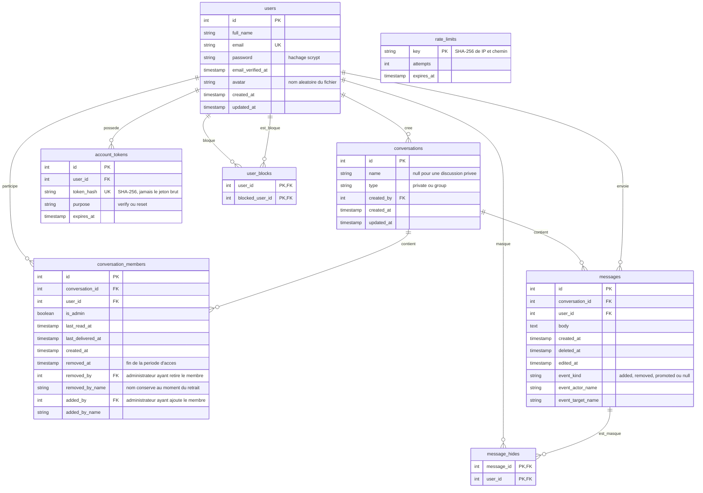

# Base de données — Kadea Chat

- La paire `(conversation_id, user_id)` est unique.
- Dans un groupe, `conversation_members.created_at` marque le dernier ajout. Un membre ne voit que les messages compris entre cette date et son éventuel `removed_at`. Une réintégration ouvre une nouvelle période ; les aperçus, recherches, compteurs et flux SSE appliquent les mêmes limites. Les conversations privées conservent leur historique normal.
- Un membre retiré conserve cette période d’historique en lecture seule et peut consulter les membres actuels. C’est un choix produit explicite ; un utilisateur extérieur n’ayant jamais été membre n’a aucun accès au groupe.
- Plusieurs administrateurs sont possibles. Seul un administrateur actif peut ajouter, retirer ou promouvoir un membre actif. Les administrateurs ne sont pas retirables par la fonction de retrait actuelle ; aucune rétrogradation n’est exposée.
- Les avis système d’ajout, retrait et promotion sont des lignes de `messages` avec `event_kind`. Ils sont créés dans la même transaction que l’action et ne peuvent pas être modifiés ou supprimés par les utilisateurs.
- `message_hides` masque un message reçu uniquement pour l’utilisateur concerné. La suppression d’un message envoyé reste globale. Les modifications de messages personnels sont limitées aux cinq minutes suivant l’envoi, avec contrôle serveur.
- Les clés étrangères préservent l'intégrité ; la suppression d'un utilisateur ou d'une conversation entraîne les suppressions liées prévues par les migrations.
- La création simultanée d'une même discussion privée est sérialisée par un verrou transactionnel PostgreSQL sur la paire d'utilisateurs.
- La suppression d'un message vide son contenu et renseigne `deleted_at`. L'historique conserve une indication de suppression.
- Les jetons de confirmation durent 24 h ; ceux de réinitialisation, 1 h. Après utilisation, les jetons de la même finalité sont supprimés.
- `last_delivered_at` signifie que le flux du destinataire a pris en charge les messages de la discussion. `last_read_at` est mis à jour lorsque la discussion est ouverte dans un onglet actif. En groupe, « Lu » signifie lu par tous les autres membres actuels.
- Les comptes existants avant la migration doivent confirmer leur adresse avec le formulaire « Confirmer mon adresse ».
